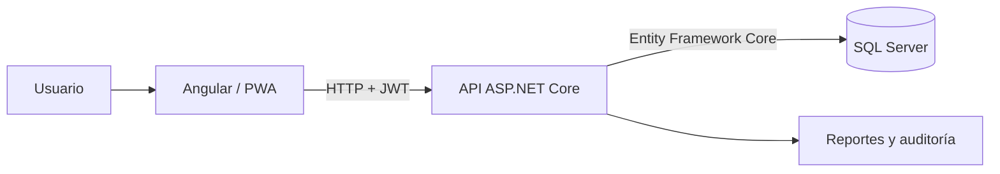

# HCU 008 — Sistema de gestión de emergencias

HCU 008 es una aplicación web full-stack para apoyar el flujo clínico de un área de emergencias: registro de pacientes, triaje, evaluación médica, diagnósticos, prescripciones, exámenes, evoluciones, egreso y generación de reportes PDF.

> **Estado del proyecto:** prototipo académico funcional, apropiado para demostración, tesis y portafolio. Antes de utilizarlo con pacientes reales se requieren infraestructura permanente, revisión de seguridad, cumplimiento legal sanitario y procedimientos operativos institucionales.

## Funcionalidades principales

- Autenticación con JWT y permisos diferenciados para **Administrador** y **Doctor**.
- Gestión de pacientes y atenciones de emergencia.
- Flujo clínico completo: triaje, evaluación, diagnósticos CIE-10, prescripciones, exámenes, evoluciones y egreso.
- Separación de pacientes por médico responsable.
- Plantillas clínicas administrables para agilizar registros frecuentes.
- Tablero de seguimiento con prioridad, estado e historial de atenciones.
- Reporte clínico resumido en PDF con datos relevantes y espacio de firma.
- Módulo de mensajería para preparar información destinada a correo o WhatsApp.
- Registro de accesos y modificaciones clínicas para auditoría.
- Aplicación web progresiva (PWA) instalable cuando se publica mediante HTTPS.

## Arquitectura



| Capa | Tecnología |
| --- | --- |
| Interfaz | Angular 21, TypeScript, HTML y CSS |
| API | ASP.NET Core 10, C# y JWT |
| Persistencia | Entity Framework Core y SQL Server |
| Reportes | jsPDF |
| Publicación | PWA, Docker Compose y Caddy/HTTPS |
| Pruebas | Vitest y proyecto de carga .NET |

## Requisitos

- Node.js 24 y npm 11.
- .NET SDK 10.
- SQL Server activo en `localhost`.
- PowerShell en Windows para utilizar los scripts incluidos.

## Inicio rápido para desarrollo

1. Clone el repositorio e ingrese en su carpeta.
2. Prepare dependencias, base de datos y configuración local:

   ```powershell
   powershell -ExecutionPolicy Bypass -File .\herramientas\PREPARAR-PRESENTACION.ps1
   ```

3. Inicie la API y Angular:

   ```powershell
   powershell -ExecutionPolicy Bypass -File .\herramientas\INICIAR-PRESENTACION.ps1
   ```

4. Abra `http://localhost:4200`.

La API de desarrollo utiliza `http://localhost:5219`. Las credenciales y claves de cada entorno deben configurarse localmente; no deben publicarse en el repositorio.

## Aplicación integrada en el puerto 8080

Para compilar Angular y publicar la API como una sola aplicación:

```powershell
powershell -ExecutionPolicy Bypass -File .\herramientas\PUBLICAR-APP-WEB.ps1
```

El resultado se genera localmente en `APP-WEB-LISTA`. Después puede iniciarse con:

```cmd
ABRIR-APP-WEB.cmd
```

La aplicación queda disponible en `http://localhost:8080`. Esta carpeta es un artefacto generado y no se almacena en Git; se reconstruye con el script anterior.

## Pruebas

Pruebas del frontend:

```powershell
npm test -- --watch=false
```

Compilación de producción:

```powershell
npm run build
dotnet build .\api\Hcu008.Api\Hcu008.Api\Hcu008.Api.csproj
```

Prueba de carga aislada contra la base `Hcu008Db_QA`:

```powershell
powershell -ExecutionPolicy Bypass -File .\herramientas\EJECUTAR-PRUEBA-CARGA-QA.ps1
```

La prueba de carga nunca debe ejecutarse contra la base clínica principal.

## Estructura del repositorio

```text
HOSPITAL/
├── api/Hcu008.Api/          API, modelos, controladores y migraciones
├── src/app/                 Aplicación Angular
├── public/                  Recursos estáticos y PWA
├── tests/Hcu008.LoadTests/  Pruebas de carga
├── herramientas/            Scripts de preparación, publicación y respaldo
├── deploy/                  Plantillas para despliegue permanente
└── documentacion/           Guías técnicas, UX, privacidad y operación
```

## Documentación

- [Guía completa](documentacion/GUIA-COMPLETA.md)
- [Diseño del sistema](documentacion/DISENO.md)
- [Guía de experiencia de usuario](documentacion/GUIA-UX.md)
- [Despliegue de producción](documentacion/DESPLIEGUE-PRODUCCION.md)
- [Plan de operación y soporte](documentacion/PLAN-OPERACION-Y-SOPORTE.md)
- [Borrador de política de privacidad](documentacion/POLITICA-PRIVACIDAD-BORRADOR.md)
- [Política de seguridad del repositorio](SECURITY.md)

## Seguridad y privacidad

- No suba archivos `.env`, respaldos `.bak`, contraseñas, claves JWT ni datos reales de pacientes.
- Use únicamente datos ficticios en demostraciones, capturas y pruebas.
- En producción, habilite HTTPS, almacene secretos fuera del código y restrinja CORS al dominio autorizado.
- Mantenga respaldos cifrados, control de acceso, auditoría y un procedimiento de restauración probado.

## Alcance

El repositorio demuestra análisis, diseño, desarrollo full-stack, persistencia, seguridad por roles, reportes, pruebas y preparación de despliegue. No constituye por sí solo un producto médico certificado ni reemplaza la validación clínica, legal y de ciberseguridad exigida por la institución que lo utilice.
